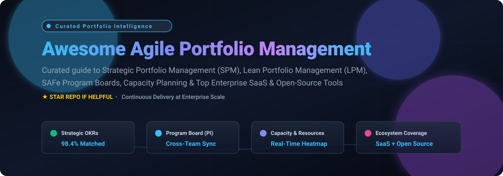

# Awesome Agile Portfolio Management 🚀

  
  
  
  
  

  <strong>Curated guide to Strategic Portfolio Management (SPM), Lean Portfolio Management (LPM), Scaled Agile (SAFe), Capacity Planning &amp; Enterprise Project Portfolio Governance.</strong>

  🌟 <em>Star this repository if you find it valuable!</em> 🌟

---

## 📑 Table of Contents

- [🌐 Sector Overview & Market Dynamics](#-sector-overview--market-dynamics)
- [☁️ Enterprise SaaS Platforms](#️-enterprise-saas-platforms)
- [💻 Open-Source Platforms & Projects](#-open-source-platforms--projects)
- [🧩 Frameworks for Custom Portfolio Stacks](#-frameworks-for-custom-portfolio-stacks)
- [🤝 How to Contribute](#-how-to-contribute)
- [☕ Support](#-support)
- [📈 Star History](#-star-history)
- [⚖️ Disclaimer](#️-disclaimer)

---

## 🌐 Sector Overview & Market Dynamics

The global **Strategic Portfolio Management (SPM)** and **Agile Project Portfolio Management (PPM)** software market is valued between **$6.8 billion and $9.8 billion**, on a rapid trajectory to exceed **$16.0B–$17.8B by the early 2030s** at an estimated **10%–14% CAGR**.

### 📊 Market Concentration vs Fragmentation
* **Moderately fragmented yet heavily concentrated at the enterprise upper tier:** Tier-1 enterprise spend is anchored by mega-cap infrastructure leaders and private-equity software powerhouses (Broadcom, IBM, Adobe, Atlassian, Planview) that deliver end-to-end strategic roadmapping, capital budgeting, and SAFe Program (PI) boards.
* **Specialist agility & product ops challengers:** Mid-market organizations and product teams increasingly deploy agile-native specialists (such as Dragonboat and Meisterplan) to solve real-time resource bottlenecks and OKR alignment.
* **Open-source self-hosted landscape:** Open-source platforms (such as OpenProject, Focalboard, and Plane) provide complete data sovereignty and agile execution, though pure Lean Portfolio Management ceremonies and capital scenario planning remain rare outside enterprise commercial tools.

---

## ☁️ Enterprise SaaS Platforms

> Below is a breakdown of category-leading Agile Portfolio Management and SPM SaaS solutions, sorted in descending order by parent company valuation / market capitalization.

| Product | Company Valuation / Revenue | Pricing (Starting Tier) | Free Tier / Free Trial Limits | Best For |
| :--- | :--- | :--- | :--- | :--- |
| **[Broadcom Rally](https://www.broadcom.com/)** | **Broadcom Inc.** (Market Cap: ~$1.6T, Annual Revenue: ~$51B+) | Custom enterprise contract; baseline enterprise seats start at **~$50–$65/user/month** (annual contract required; custom quotes via Broadcom Sales/Partners) | **No free-forever plan**; offers requestable sales-led enterprise pilot / guided evaluation sandbox (typically 30 days upon sales qualification) | Enterprises with existing Broadcom/CA investments needing agile ALM and planning at scale |
| **[Clarity PPM](https://www.broadcom.com/)** | **Broadcom Inc.** (Market Cap: ~$1.6T, Annual Revenue: ~$51B+) | AWS Marketplace / partner list pricing starts at **$660/user/year** (~$55/user/month) for Full Function Users; Restricted Users start at **$336/year** (~$28/user/month) | **No free-forever plan**; custom proof-of-concept (PoC) / guided demo sandbox available upon enterprise sales qualification (typically 14–30 days) | Large enterprises requiring formal PPM governance, financial accounting, and capital investment oversight |
| **[Targetprocess](https://www.targetprocess.com/)** (Apptio) | **IBM** (Market Cap: ~$240B, Annual Revenue: ~$62B+) *(Acquired Apptio for $4.6B)* | Custom enterprise pricing; public framework/G-Cloud benchmarks start at **£12–£32 (~$15–$40)/user/month** (typically 10-user minimum commitment) | **No free-forever plan**; requestable 30-day guided enterprise trial available upon registration/sales contact | Mid-market to enterprise organizations wanting customizable agile portfolio visualization (SAFe, LeSS, Kanban) |
| **[Workfront](https://www.workfront.com/)** | **Adobe** (Market Cap: ~$100B, Annual Revenue: ~$21B+) *(Acquired for $1.5B)* | Enterprise quote only; industry benchmarks for entry Select tier start at **~$30–$50/user/month** (billed annually, custom contracts) | **No self-serve free tier**; sales-assisted customized proof-of-concept / guided sandbox environment available for enterprise evaluations (typically 14–30 days) | Enterprises wanting unified work, project, and portfolio management across IT, PMO, and marketing |
| **[Portfolio for Jira](https://www.atlassian.com/software/jira)** (Advanced Roadmaps) | **Atlassian** (Market Cap: ~$54B, Annual Revenue: ~$4.4B+) | Included in **Jira Cloud Premium** starting at **$14.50–$16.00/user/month** (sliding scale down to lower average per-seat cost at higher volumes) | **Free tier available**: Basic single-project roadmaps on Jira Free (up to 10 users, 2GB storage); full Advanced Roadmaps / Plans features require **30-day Jira Cloud Premium free trial** (up to 10,000 users) | Jira-centric teams wanting portfolio roadmapping and cross-project dependency mapping within Atlassian |
| **[Jira Align](https://www.atlassian.com/software/jira/align)** | **Atlassian** (Market Cap: ~$54B, Annual Revenue: ~$4.4B+) | Sold via Atlassian Strategy Collection; base tier starts at **$77,400/year** (covers 1–50 users, effective ~$129/user/month at 50 seats; requires underlying Jira Premium/Enterprise) | **No self-service free tier or trial**; Atlassian provides guided enterprise Launchpad evaluation environments and custom demo walkthroughs upon sales engagement | Global enterprises implementing scaled agile frameworks (SAFe, LeSS, Spotify) requiring strategy-to-delivery alignment |
| **[Planview](https://www.planview.com/)** | **TPG / TA Associates** (Valuation: $1.6B at buyout, Annual Revenue: ~$410M+) | Enterprise quote; annual enterprise deployments typically start at **$50,000+/year** (team-level tools like AgilePlace / ProjectPlace start at ~$19–$29/user/month) | **No free-forever plan**; **30-day fully functional free trial** available for Planview ProjectPlace and AgilePlace (unlimited projects/boards; enterprise Portfolios requires guided sales demo) | Enterprise PMOs needing mature portfolio traceability, capacity heatmaps, scenario modeling, and capital governance |
| **[Digital.ai Agility](https://digital.ai/)** | **TPG Capital** (Valuation: Private, Annual Revenue: ~$140M–$230M) | Quote-based enterprise subscription; baseline user tiers historically benchmarked starting at **~$29/user/month** (annual contract required) | **No free-forever plan**; requestable 14 to 30-day evaluation trial under Software Evaluation Agreement upon sales approval | Organizations needing enterprise agile planning tightly integrated with DevOps release orchestration |
| **[Dragonboat](https://www.dragonboat.io/)** | **Dragonboat.io** (Valuation: ~$50M–$100M venture-backed, ARR: ~$3M–$5M, $15M funding) | Custom quote subscription; entry-tier creator seats historically benchmarked at **~$49–$99/user/month** (billed annually) | **No free-forever plan for creators**; includes up to **100 free view/requestor stakeholder seats**; offers 14-day requestable free trial upon demo setup | Product operations and product management teams requiring data-driven capacity allocation and OKR alignment |
| **[Meisterplan](https://meisterplan.com/)** | **itdesign GmbH** (Annual Revenue: ~$25M; Meisterplan unit ARR: ~$4.6M) | Resource-based pricing; Basic tier starts at **$600/month** (flat rate covering up to 50 active resources with unlimited free login users; ~$12/resource/month equivalent) | **30-day fully functional free trial** (no credit card required; full access to Pro Edition features and scenario planning) | Organizations seeking lean project portfolio management centered strictly on resource capacity planning and prioritization |

---

## 💻 Open-Source Platforms & Projects

> Curated open-source portfolio and agile management platforms, **sorted in descending order by GitHub Stars_Count**. Each badge displays live Stars_Counts and directly links to the project's GitHub stargazers page.

- ### ✈️ **[Plane](https://github.com/makeplane/plane)** 
  - **Description**: Fast-growing modern open-source project management platform positioned as an extensible, developer-friendly alternative to Jira, Linear, and Monday.
  - **Features**: Sprints/cycles, modules, issue triage, project analytics, burn-down metrics, and rich-text docs with collaborative pages.
  - **License**: AGPL-3.0
  - **Tech Stack**: Next.js, TypeScript, Python, PostgreSQL, Redis
  - **Deployment**: Docker, Kubernetes, Plane Cloud
  - **Portfolio Role**: Team-level issue tracking and release sprints; pairs well with higher-level portfolio dashboards.

- ### 📋 **[Focalboard](https://github.com/mattermost/focalboard)** 
  - **Description**: Open-source, multilingual alternative to Trello, Notion, and Asana created by Mattermost for tracking projects across cross-functional teams.
  - **Features**: Kanban boards, table views, calendar schedules, gallery views, task card attributes, multi-board dashboarding, and role-based permissions.
  - **License**: AGPL-3.0
  - **Tech Stack**: Go, TypeScript, React, PostgreSQL/SQLite
  - **Deployment**: Standalone server, Mattermost integration, Docker
  - **Portfolio Role**: Cross-team initiative boards, program milestone tracking, and shared delivery views.

- ### 🗂️ **[Wekan](https://github.com/wekan/wekan)** 
  - **Description**: Distributed FLOSS Kanban board platform with extensive swimlane and board-of-boards capabilities.
  - **Features**: Multi-board views, swimlanes for cross-team tracking, custom fields, rule-based automation, time tracking, LDAP/SSO authentication.
  - **License**: MIT
  - **Tech Stack**: Meteor, Node.js, MongoDB
  - **Deployment**: Docker, Snap, Source
  - **Portfolio Role**: Program-level visual coordination, cross-department Kanban boards, and work-in-progress (WIP) limit enforcement.

- ### 🏢 **[OpenProject](https://github.com/opf/openproject)** 
  - **Description**: Leading sovereign open-source project and portfolio management software with native multi-project hierarchies and enterprise governance.
  - **Features**: Enterprise multi-project portfolios, SAFe/Agile boards, interactive Gantt timelines, roadmapping, resource capacity allocation, cost reporting, and budgeting.
  - **License**: GPL-3.0
  - **Tech Stack**: Ruby on Rails, Angular, PostgreSQL
  - **Deployment**: Docker, Helm chart, Debian/RPM packages, OpenProject Cloud
  - **Portfolio Role**: The most complete open-source equivalent for enterprise PMO portfolio oversight, budget compliance, and SAFe program management.

- ### 📊 **[Planka](https://github.com/plankanban/planka)** 
  - **Description**: Modern, lightweight, and elegant open-source Kanban tracking system designed for agile teams and project boards.
  - **Features**: Real-time card updates, markdown descriptions, custom labels, background customization, attachments, user mentions, and project grouping.
  - **License**: AGPL-3.0
  - **Tech Stack**: React, Redux, Node.js, PostgreSQL
  - **Deployment**: Docker, Docker Compose
  - **Portfolio Role**: Fast departmental tracking and project-level kanban execution.

- ### 🎯 **[Leantime](https://github.com/leantime/leantime)** 
  - **Description**: Strategic and goal-focused open-source project management platform built to bridge strategy, ideation, and execution.
  - **Features**: Strategy boards (Lean Canvas), strategic milestone roadmaps, OKR tracking, idea management, Gantt charts, sprint planning, and ADHD-friendly accessibility features.
  - **License**: AGPL-3.0
  - **Tech Stack**: PHP, JavaScript, MySQL
  - **Deployment**: Docker, LAMP stack
  - **Portfolio Role**: Strategic alignment, OKR-to-project mapping, and early-stage lean portfolio validation.

- ### 📌 **[Kanboard](https://github.com/kanboard/kanboard)** 
  - **Description**: Minimalist, fast, and dependency-light visual task board system focusing on simplicity and flow.
  - **Features**: Kanban boards, swimlanes, subtasks, automated board actions, analytics (CFD, burn-down), and plugin ecosystem.
  - **License**: MIT
  - **Tech Stack**: PHP, SQLite/PostgreSQL/MySQL
  - **Deployment**: Docker, single archive install
  - **Portfolio Role**: Lightweight work stream coordination across autonomous service teams.

- ### ⛏️ **[Redmine](https://github.com/redmine/redmine)** 
  - **Description**: Veteran, highly extensible open-source project management web application with multi-project tracking capabilities.
  - **Features**: Multi-project management, role-based access control, issue tracking, Gantt charts, calendars, time logging, and rich plugin directory for agile boards.
  - **License**: GPL-2.0
  - **Tech Stack**: Ruby on Rails, MySQL/PostgreSQL/SQLite
  - **Deployment**: Docker, native source install
  - **Portfolio Role**: Stable, multi-project IT portfolio governance and cross-system issue tracking.

- ### ⏱️ **[Vikunja](https://github.com/go-vikunja/vikunja)** 
  - **Description**: Modern end-to-end open-source task and project management suite with clean UI and multi-view flexibility.
  - **Features**: List, Kanban, Gantt, and table views; subtasks; labels; team namespaces; reminders; and comprehensive REST API.
  - **License**: AGPL-3.0
  - **Tech Stack**: Go, Vue.js, SQLite/PostgreSQL/MySQL
  - **Deployment**: Docker, binary release
  - **Portfolio Role**: Distributed team task portfolios and cross-project initiative delivery.

- ### 🌲 **[Taiga](https://github.com/taigaio/taiga-docker)** 
  - **Description**: Open-source agile project management platform designed for cross-functional teams with Scrum and Kanban workflows.
  - **Features**: Scrum boards, sprint backlogs, epics management, user story estimation, WIP limits, wiki, and real-time dashboard analytics.
  - **License**: MPL-2.0
  - **Tech Stack**: Python (Django), AngularJS/React, PostgreSQL, Docker
  - **Deployment**: Docker Compose, Taiga Cloud
  - **Portfolio Role**: Agile delivery execution and team-level Scrum/Kanban backlogs.

- ### 🏛️ **[LibrePlan](https://github.com/LibrePlan/libreplan)** 
  - **Description**: Governance-oriented open-source web application for enterprise project and resource planning.
  - **Features**: Multi-project planning, company-wide resource allocation, milestone tracking, risk registers, project pipeline management, and audit trails.
  - **License**: AGPL-3.0
  - **Tech Stack**: Java, Spring, PostgreSQL
  - **Deployment**: Docker, Tomcat
  - **Portfolio Role**: Public sector and regulated environment portfolio governance with deterministic scheduling.

- ### 🚢 **[Kendis (Scaling Container)](https://hub.docker.com/r/kendisdocker/kendis)**
  - **Description**: Enterprise agile scaling platform with real-time Program Board for SAFe, Spotify, and LeSS models *(Proprietary engine distributed via Docker)*.
  - **Features**: Visual Program Boards, 2-way Jira / Azure DevOps synchronization, cross-team dependency mapping, and PI planning ceremonies.
  - **Deployment**: Docker (`docker pull kendisdocker/kendis`)
  - **Note**: Proprietary commercial software distributed as a container; verify vendor licensing before deployment.

---

## 🧩 Frameworks for Custom Portfolio Stacks

Can an enterprise assemble an open-source Agile Portfolio Management platform?
1. **Portfolio Backbone & Governance**: Use **OpenProject** for strategic hierarchy, enterprise multi-project budgets, resource heatmaps, and executive reporting.
2. **Strategy & OKR Linkage**: Integrate **Leantime** to map executive OKRs and Lean Canvas initiatives into actionable goals.
3. **Team-Level Agile Execution**: Deploy **Plane** or **Taiga** for fast developer sprints, cycle tracking, and issue workflows.
4. **Visual Program Boards & Dependencies**: Leverage **Focalboard** or **Wekan** (or **Kendis** container if commercial terms permit) to map cross-team dependencies during Program Increment (PI) planning.

---

## 🤝 How to Contribute

Contributions are welcome! Help us keep this curated directory comprehensive, accurate, and up to date:

1. **Fork** this repository.
2. **Add/Update** your tool entry in `README.md` (keep entries objective, factual, and strictly follow the established table/list formatting).
3. **Include**: Product name, official link, 1–2 sentence description, open-source license (if applicable), and clear deployment options.
4. **Submit a Pull Request** with a concise description of your update.

---

## ☕ Support

If you found this curated list helpful for your enterprise architecture, PMO research, or open-source tooling evaluations, please consider supporting the project:

- 🌟 **Star this repository** to improve visibility across the GitHub developer ecosystem!
- 🍴 **Fork and share** with your agile coaching, engineering leadership, and product operations networks.
- ☕ **Buy a coffee & sponsor** ongoing maintenance through the [GitHub Sponsor Dashboard](https://github.com/sponsors/ishandutta2007).

Thank you for helping keep agile portfolio management open, transparent, and accessible to everyone! ❤️

---

## 📈 Star History

---

## ⚖️ Disclaimer

- This is a community-curated directory intended solely for educational, evaluation, and architectural research purposes.
- Mentions of commercial and SaaS platforms (such as Jira Align, Planview, Broadcom Rally, Workfront, and Targetprocess) do not constitute formal endorsements.
- Portfolio platforms handle highly confidential strategic roadmap, financial allocation, and organizational capacity data. Ensure any self-hosted or SaaS deployment adheres to strict security, role-based access control (RBAC), and regulatory standards (GDPR, SOC 2, ISO 27001).

---

  Made with ❤️ for developers, PMO leaders, agile coaches, and engineering organizations worldwide.

